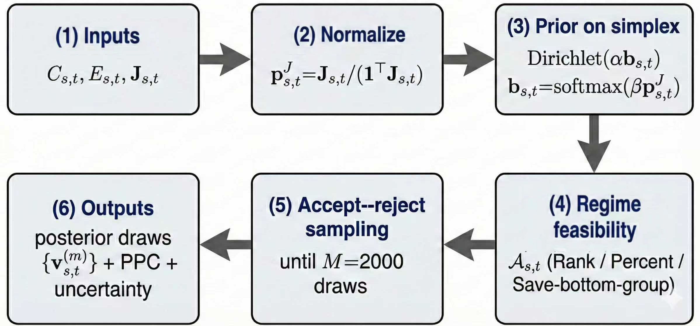
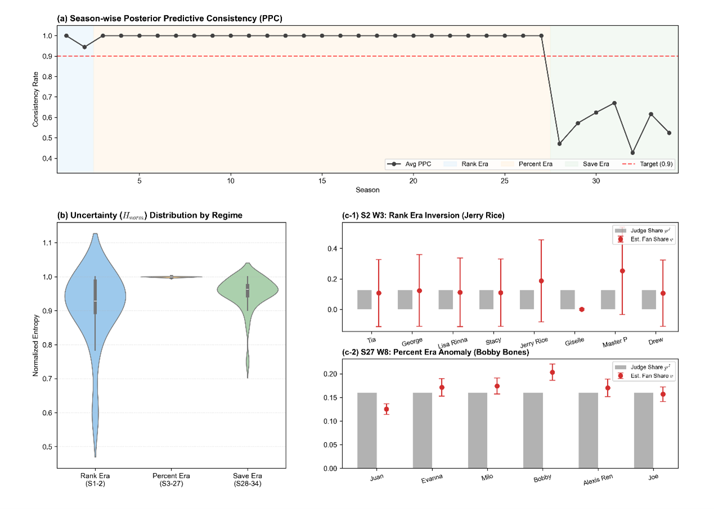
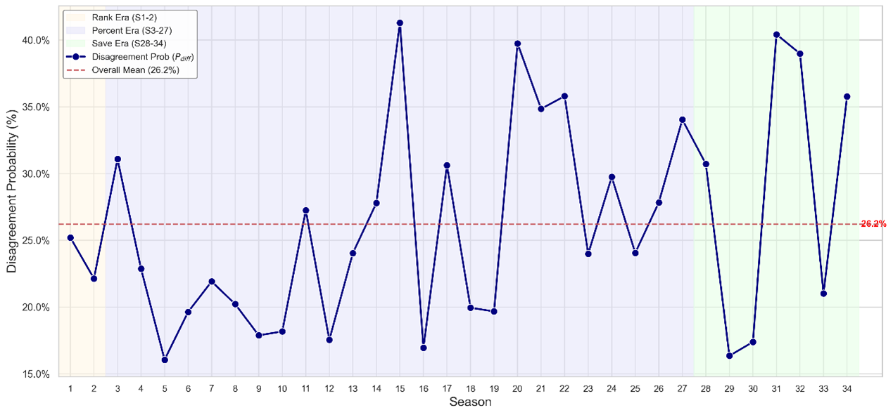
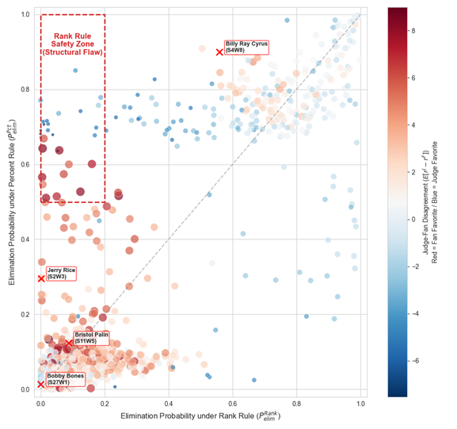
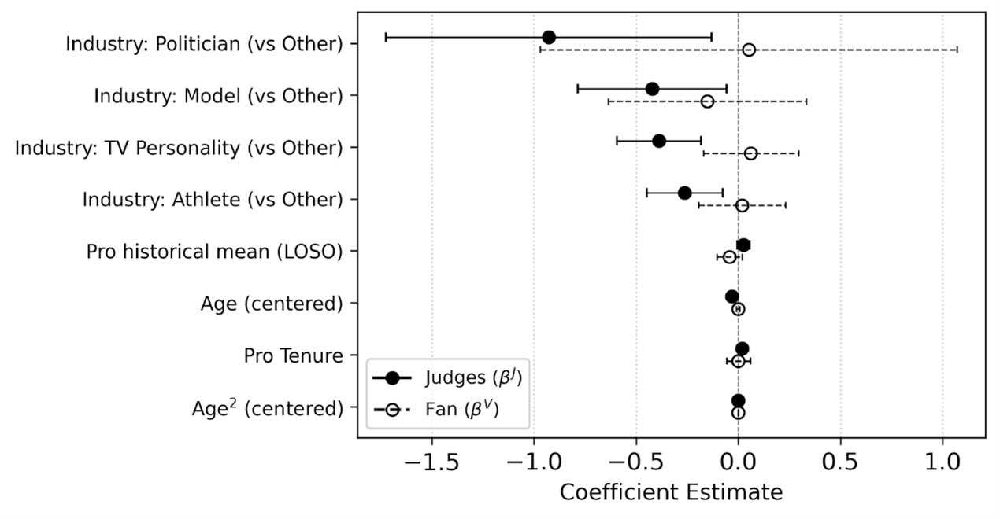
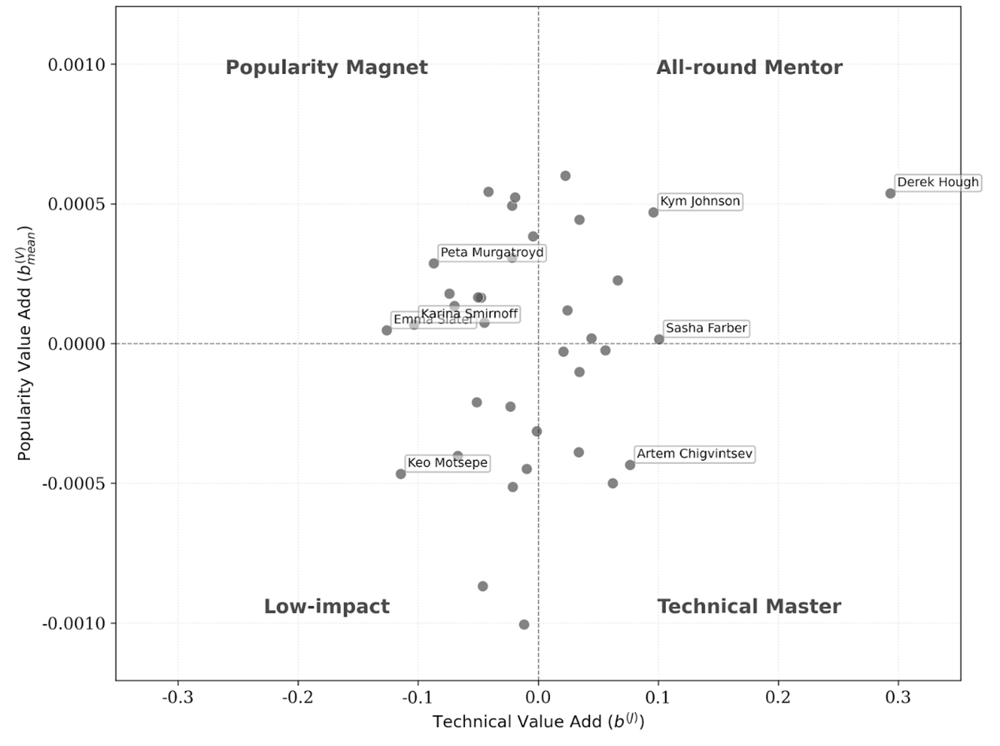
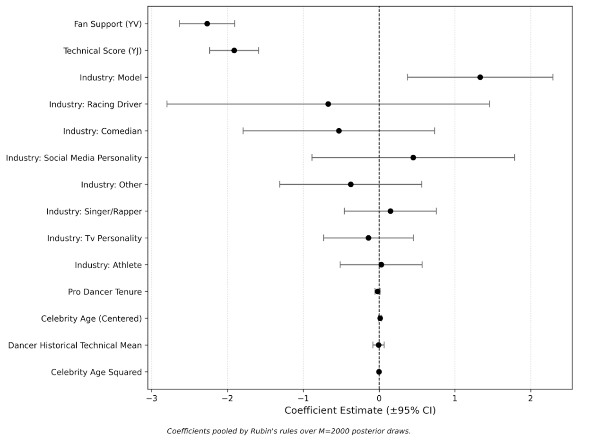
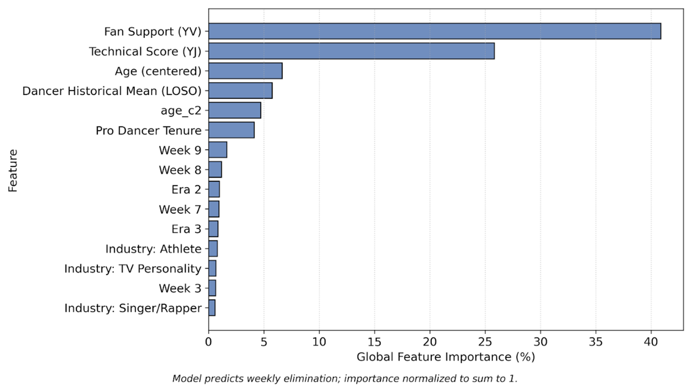

<h1 align="center">PAGS</h1>

<p align="center">
  <strong>Auditing DWTS Voting Aggregation Rules<br>via Inverse Reconstruction and Counterfactual Simulation</strong>
</p>

<p align="center">
  <strong>2026 MCM/ICM · Problem C · Finalist</strong>
</p>

<p align="center">
  <a href="论文.pdf"><strong>Paper</strong></a> ·
  <a href="latex项目/main.tex">LaTeX</a> ·
  <a href="#main-results">Results</a> ·
  <a href="#code-and-materials">Code</a> ·
  <a href="README.zh-CN.md">简体中文</a> ·
  <a href="https://github.com/739542/2026-C-Finalist-">Original materials</a>
</p>

<p align="center">
  Reconstruct hidden fan support. Measure the effect of voting rules.<br>
  Design transparent safeguards for the balance between technical merit and audience choice.
</p>

| **90.5%** | **26.0%** | **0.419 → 0.497** | **85.6%** |
| :---: | :---: | :---: | :---: |
| Posterior predictive consistency | Mean rule disagreement | Professionalism: Percent → PAGS | PAGS elimination probability, Bobby Bones S27W8 |

Results reported in the paper. Rule comparisons average posterior simulations over **264 elimination weeks**, with **2,000 vote-share draws per week**; 85.6% is a counterfactual case result.

## Overview

In *Dancing with the Stars*, judges' scores and eliminations are public, but fan vote totals are hidden. This makes it difficult to distinguish audience preference from the effect of the aggregation rule itself.

We build a connected framework that infers feasible fan-vote distributions, compares alternative rules under the same weekly information, separates technical and popularity signals, and evaluates **PAGS — the Professional–Adaptive Guard System**.

<p align="center"><strong>Reconstruct votes</strong> → <strong>Audit rules &amp; explain risk</strong> → <strong>Design PAGS</strong></p>

<p align="center">
  <a href="assets/readme/inverse-reconstruction.png"></a>
</p>

<p align="center"><em>The Q1 reconstruction pipeline used to infer hidden vote shares and carry uncertainty into downstream analysis. Original paper Figure 1.</em></p>

## Method

1. **Recover vote distributions, not a single guessed vote.** A Dirichlet prior and historical rule constraints define admissible weekly fan shares. Posterior samples retain the uncertainty of the inverse problem.
2. **Change the rule while holding the week fixed.** Compare Rank, Percent, and judge-save variants using the same observed scores and sampled audience support.
3. **Separate three channels.** Mixed-effects models describe judges' scores and conditional fan preference; a discrete-time hazard model connects both to elimination risk. Multiple imputation carries Q1 uncertainty forward.
4. **Turn the diagnosis into an explicit rule.** PAGS combines adaptive vote compression, phase-dependent judge weighting, and a minimal-intervention guardrail.

## Main results

### 1. Hidden fan support can be reconstructed with explicit uncertainty

The paper reports **90.5% posterior predictive consistency (PPC)** on elimination weeks. Season-level diagnostics, posterior entropy, and contestant-level intervals expose where inverse reconstruction is informative and where uncertainty remains wide.

<p align="center">
  <a href="assets/readme/posterior-diagnostics.png"></a>
</p>

<p align="center"><em>Posterior diagnostics across historical regimes and two case weeks. Original paper Figure 2. PPC measures consistency with observed eliminations; it is not accuracy against observed fan-vote totals.</em></p>

### 2. The aggregation rule changes elimination risk

Across **264 elimination weeks**, mean posterior disagreement between Rank and Percent is **0.260**. The same judge scores and fan support can therefore produce different elimination sets under different rules. The paper also reports higher overall alignment with fan ordering for Percent: **0.765 vs. 0.678** mean Spearman correlation.

<p align="center">
  <a href="assets/readme/rule-disagreement.png"></a>
</p>

<p align="center"><em>How Rank–Percent disagreement varies by season. The dashed line marks the reported 26% overall mean.</em></p>

<details>
<summary><strong>Case-level view: where Rank and Percent disagree</strong></summary>

<p align="center">
  <a href="assets/readme/risk-conflict-map.png"></a>
</p>

Each point is a contestant-week. Points away from the diagonal reveal sensitivity to the aggregation rule; the upper-left region highlights cases protected by Rank but exposed under Percent. Original paper Figure 5.

</details>

### 3. Technical uplift and popularity transfer are different partner contributions

Professional partners are characterized through both technical and popularity channels. The channel comparison and residual-effect map distinguish technical specialists, popularity contributors, and partners with strength in both dimensions.

<table>
  <tr>
    <td width="52%" align="center"><a href="assets/readme/channel-effects.png"></a></td>
    <td width="48%" align="center"><a href="assets/readme/partner-value-add.png"></a></td>
  </tr>
  <tr>
    <td align="center"><strong>Judge–fan channel contrast</strong></td>
    <td align="center"><strong>Professional-partner value add</strong></td>
  </tr>
</table>

Both panels appear in original paper Figure 6. Effects are conditional associations after covariate adjustment.

### 4. Elimination depends on both performance and fan support

The hazard model and random forest diagnostic identify **fan support and technical score** as leading predictors. Across the six shared substantive covariates, the paper reports **Spearman rank agreement of 0.657** between hazard-effect magnitudes and random forest importances.

<table>
  <tr>
    <td width="48%" align="center"><a href="assets/readme/elimination-hazard.png"></a></td>
    <td width="52%" align="center"><a href="assets/readme/feature-importance.png"></a></td>
  </tr>
  <tr>
    <td align="center"><strong>Discrete-time elimination hazard</strong></td>
    <td align="center"><strong>Random forest diagnostic</strong></td>
  </tr>
</table>

Original paper Figure 7. The two model classes provide complementary evidence about the hierarchy of predictors.

### 5. PAGS makes the merit–agency trade-off explicit

PAGS compresses extreme vote concentration, increases the weight of technical judging as the season advances, and protects top technical performers under a declared guardrail. Its evaluation reports three criteria: **professionalism (P)**, **audience agency (A)**, and **drama (D)**.

| Mechanism | Professionalism P | Audience agency A | Drama D |
| :--- | ---: | ---: | ---: |
| Percent baseline | 0.419 | **0.583** | 0.234 |
| **PAGS** | **0.497** | 0.503 | **0.253** |

*Original paper Table 5. Posterior-averaged historical simulation with M = 2,000. The selected configuration increases professionalism under the design constraint A ≥ 0.5.*

| Stress-test case | Percent elimination probability | PAGS elimination probability |
| :--- | ---: | ---: |
| Bobby Bones · Season 27, Week 8 | ≈ 0.000 | **0.856** |
| Jerry Rice · Season 2, Week 3 | — | 0.247 |

*Original paper Eq. (29). These are simulated weekly probabilities. The two cases distinguish an extreme popularity–merit divergence from moderate technical underperformance; “—” denotes an omitted comparison value.*

## Code and materials

| Resource | Entry point |
| :--- | :--- |
| **Full paper** | [论文.pdf](论文.pdf) |
| **LaTeX project** | [latex项目/main.tex](latex项目/main.tex) |
| Q1 · Vote reconstruction | [Code and plotting index](Q1/README.md) |
| Q2 · Rule comparison | [Code and plotting index](Q2/README.md) |
| Q3 · Partner effects and survival | [Code and plotting index](Q3/README.md) |
| Q4 · PAGS and alternative rules | [Code and plotting index](Q4/README.md) |
| Q5 · Producer memo | [Memo source](latex项目/6.memo.tex) |
| Robustness | [Audit and plotting scripts](稳健性/README.md) |
| Data preprocessing and checks | [Shared scripts](公共/README.md) |

```text
.
├── README.md / README.zh-CN.md
├── 论文.pdf
├── latex项目/                 # Main TeX, class file, sections and paper figures
├── assets/readme/             # Selected original paper figures
├── Q1/ ... Q4/                # Model, data-preparation and plotting scripts
├── Q5/                       # Producer-memo guide
├── 稳健性/                    # Sensitivity and robustness scripts
├── 公共/                      # Preprocessing and data checks
├── 其他/                      # Examples and files awaiting classification
└── docs/                     # Archive notes and figure provenance
```

<details>
<summary><strong>Code status, data, and building the paper</strong></summary>

- The **41 Python files** are organized copies of the local modeling scripts. Data paths and cross-question imports retain their original conventions; consult [the archive notes](docs/code-archive.md) before running them.
- Input data and full model outputs are separate from this code copy. The [original materials repository](https://github.com/739542/2026-C-Finalist-) contains additional results, including a Parquet version of the large vote-sample table.
- The LaTeX entry point is `latex项目/main.tex`. This source has been compared with the 26-page paper: extracted text and all page renders matched at 96 DPI. Full-width parentheses in `4.AI.tex` currently cause strict pdfLaTeX errors and need handling for a clean build.
- Headline numbers and tables above are **paper-reported results**; preparing this README did not rerun the models.

</details>

## Citation

```bibtex
@misc{pags2026,
  author       = {{MCM/ICM 2026 Team}},
  title        = {{PAGS}: Auditing {DWTS} Voting Aggregation Rules via
                  Inverse Reconstruction and Counterfactual Simulation},
  year         = {2026},
  howpublished = {2026 MCM/ICM, Problem C},
  url          = {https://github.com/xtt-learner/PAGS-MCM2026-Finalist}
}
```

Figure sources and editorial notes: [figure provenance](docs/figure-provenance.md).
