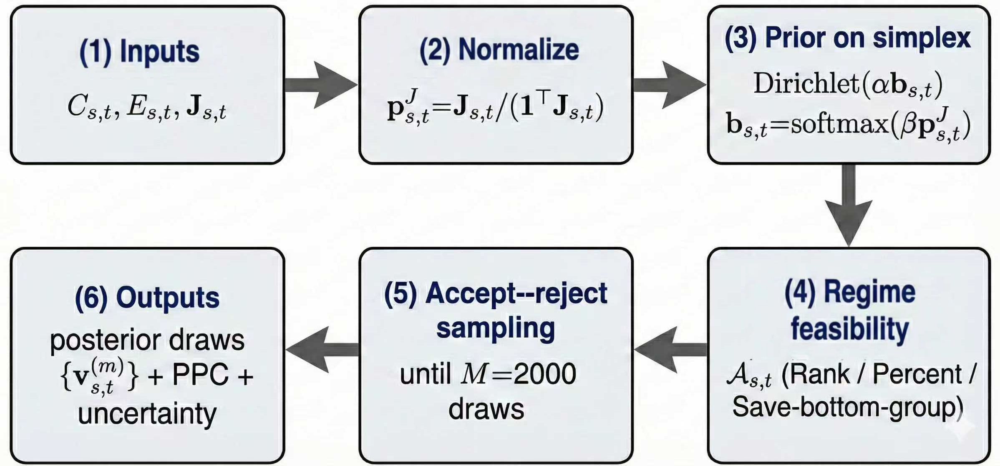
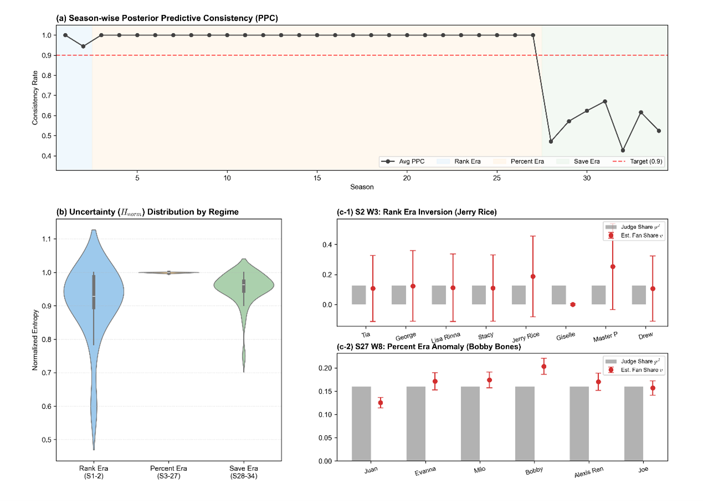
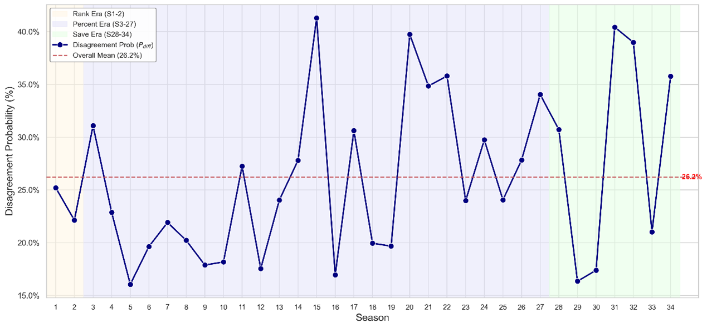
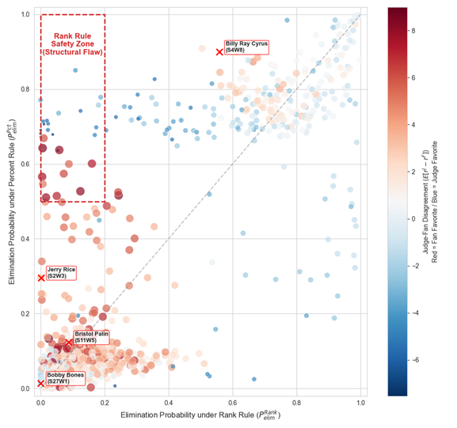
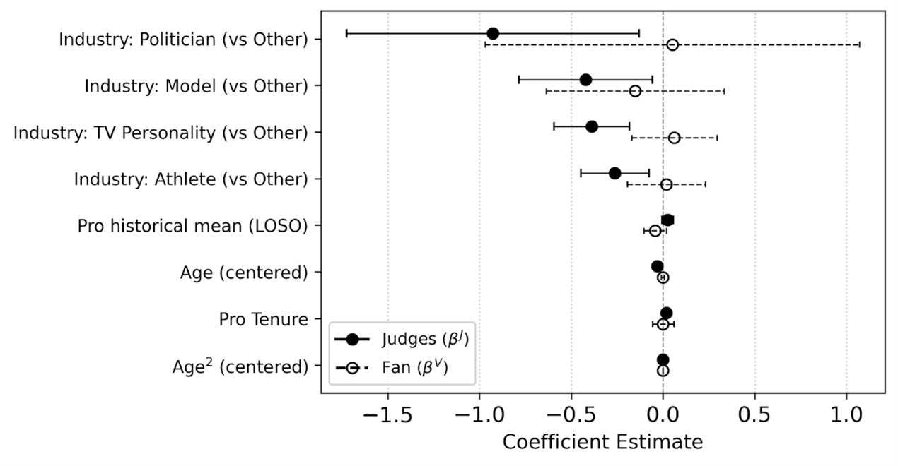
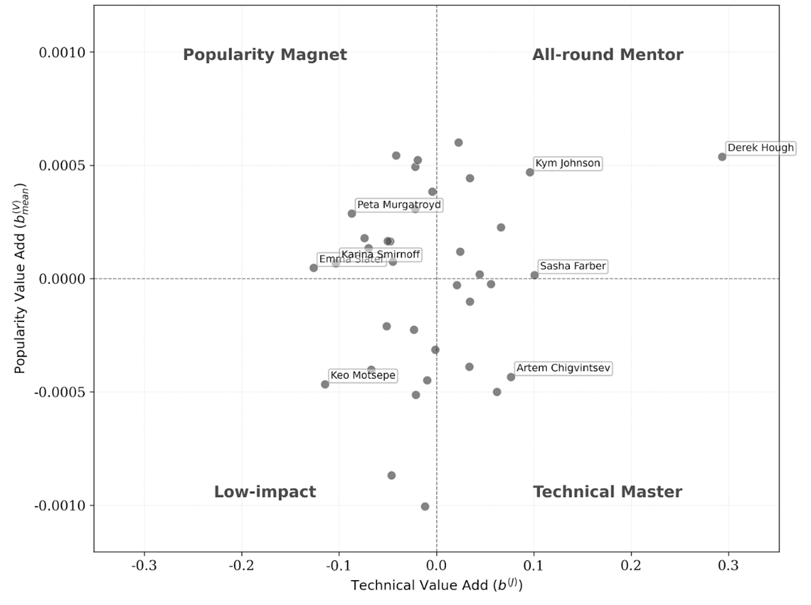
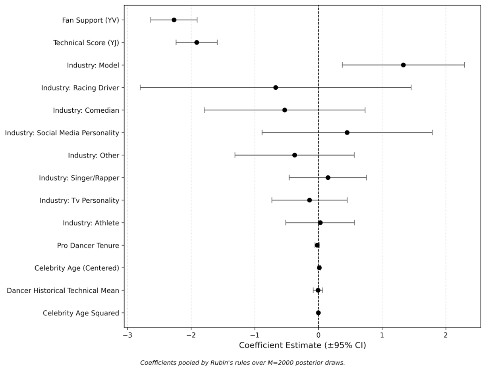
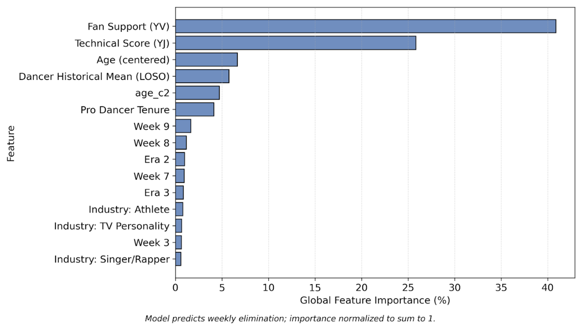

<h1 align="center">PAGS</h1>

<p align="center">
  <strong>Auditing DWTS Voting Aggregation Rules<br>via Inverse Reconstruction and Counterfactual Simulation</strong><br>
  基于潜在投票反演与反事实仿真的 DWTS 投票规则审计
</p>

<p align="center">
  <strong>2026 MCM/ICM · C 题 · Finalist</strong><br>
  Team #2619541
</p>

<p align="center">
  <a href="论文.pdf"><strong>论文 PDF</strong></a> ·
  <a href="latex项目/main.tex">LaTeX 工程</a> ·
  <a href="#核心结果">核心结果</a> ·
  <a href="#代码与资料">代码与资料</a> ·
  <a href="README.md">English</a> ·
  <a href="https://github.com/739542/2026-C-Finalist-">原论文资料仓库</a>
</p>

<p align="center">
  反演不可见的观众支持，量化投票规则的制度效应，<br>
  以透明的保护机制协调技术表现与观众选择。
</p>

| **90.5%** | **26.0%** | **0.419 → 0.497** | **85.6%** |
| :---: | :---: | :---: | :---: |
| 后验预测一致性 PPC | Rank–Percent 平均分歧率 | 专业性指标：Percent → PAGS | Bobby Bones S27W8 的 PAGS 淘汰概率 |

以上为论文报告结果。规则比较覆盖 **264 个淘汰周**，每周传播 **2,000 个票份额后验样本**；85.6% 是特定案例中的反事实仿真概率。

## 研究概览

《Dancing with the Stars》的评委评分和淘汰记录公开，粉丝投票总量却不可见。要解释争议淘汰，既需要重建潜在观众支持，也需要区分支持本身与投票聚合公式造成的影响。

本文将投票反演、赛制比较、影响归因和机制设计连接起来，提出 **PAGS（Professional–Adaptive Guard System）**，用可审计的规则处理技术表现与人气的极端背离。

<p align="center"><strong>反演潜在投票</strong> → <strong>比较规则与解释风险</strong> → <strong>设计 PAGS</strong></p>

<p align="center">
  <a href="assets/readme/inverse-reconstruction.png"></a>
</p>

<p align="center"><em>Q1 潜在投票反演流程。后验样本与不确定性继续传递至下游分析，对应论文图 1。</em></p>

## 方法亮点

1. **从单点猜测转向分布反演。** 将周票份额表示为单纯形上的向量，以 Dirichlet 先验和历史赛制约束构造可行后验，保留潜在投票的不确定性。
2. **在同一周内比较赛制。** 固定评委得分和后验票样本，比较 Rank、Percent 及评委拯救机制的淘汰结果。
3. **分离评委、粉丝和生存三个通道。** 结合混合效应模型、多重插补和离散时间 hazard 模型，区分技术提升、人气转移与淘汰风险。
4. **把规则诊断转化为机制设计。** PAGS 通过自适应票份额压缩、阶段性权重和最小干预保护机制，明确技术表现与观众选择的权衡。

## 核心结果

### 1. 用后验分布重建潜在粉丝支持

论文在淘汰周报告 **90.5% 的后验预测一致性（PPC）**。按赛季的诊断、赛制间的后验熵，以及选手层面的区间估计，共同展示反演的信息量和不确定性。

<p align="center">
  <a href="assets/readme/posterior-diagnostics.png"></a>
</p>

<p align="center"><em>不同历史赛制下的后验诊断与两个典型周，对应论文图 2。PPC 衡量与已知淘汰记录的一致性，不是对真实粉丝票数的预测准确率。</em></p>

### 2. 聚合公式会改变淘汰风险

在 **264 个淘汰周**中，Rank 与 Percent 的平均后验分歧率为 **0.260**。相同评分、相同潜在观众支持，经过不同规则后可能产生不同淘汰集合。论文还报告，Percent 与粉丝偏好排序的总体一致性更高：平均 Spearman 相关系数为 **0.765，对比 Rank 的 0.678**。

<p align="center">
  <a href="assets/readme/rule-disagreement.png"></a>
</p>

<p align="center"><em>赛制分歧率随赛季的变化；虚线表示论文报告的 26% 总体均值。</em></p>

<details>
<summary><strong>展开案例视图：哪些选手周对赛制最敏感？</strong></summary>

<p align="center">
  <a href="assets/readme/risk-conflict-map.png"></a>
</p>

每个点代表一个选手周。偏离对角线意味着该选手的风险对聚合规则敏感；左上区域突出 Rank 下受保护、Percent 下风险较高的情形，对应论文图 5。

</details>

### 3. 舞伴的技术贡献与人气贡献可以分开刻画

职业舞伴的作用具有通道差异。固定效应对比和舞伴残差效应象限，将技术提升与人气转移区分开，呈现技术型、人气型以及双通道贡献较高的舞伴。

<table>
  <tr>
    <td width="52%" align="center"><a href="assets/readme/channel-effects.png"></a></td>
    <td width="48%" align="center"><a href="assets/readme/partner-value-add.png"></a></td>
  </tr>
  <tr>
    <td align="center"><strong>评委与粉丝通道对比</strong></td>
    <td align="center"><strong>职业舞伴的双通道增益</strong></td>
  </tr>
</table>

两图对应论文图 6，估计结果表示控制可观测协变量后的条件关联。

### 4. 技术表现与粉丝支持共同影响淘汰

离散时间 hazard 模型和随机森林均将**粉丝支持与技术得分**识别为主要预测因素。在六个共享的实质性协变量上，论文报告 hazard 效应绝对值与随机森林重要性排序的 **Spearman 相关系数为 0.657**。

<table>
  <tr>
    <td width="48%" align="center"><a href="assets/readme/elimination-hazard.png"></a></td>
    <td width="52%" align="center"><a href="assets/readme/feature-importance.png"></a></td>
  </tr>
  <tr>
    <td align="center"><strong>离散时间淘汰风险模型</strong></td>
    <td align="center"><strong>随机森林诊断</strong></td>
  </tr>
</table>

对应论文图 7，两类模型为驱动因素的层次提供互补证据。

### 5. PAGS 将专业性与观众自主性的权衡显式化

PAGS 压缩极端票份额优势，随赛程推进提高技术评分的权重，并通过预先声明的保护条件实施最小干预。论文以**专业性（P）**、**观众自主性（A）**和**戏剧性（D）**三个指标评估赛制。

| 机制 | 专业性 P | 观众自主性 A | 戏剧性 D |
| :--- | ---: | ---: | ---: |
| Percent 基线 | 0.419 | **0.583** | 0.234 |
| **PAGS** | **0.497** | 0.503 | **0.253** |

*对应论文表 5。结果为 M = 2,000 的后验传播历史仿真均值；选定配置在 A ≥ 0.5 的设计约束下提高专业性。*

| 压力测试案例 | Percent 淘汰概率 | PAGS 淘汰概率 |
| :--- | ---: | ---: |
| Bobby Bones · 第 27 季第 8 周 | ≈ 0.000 | **0.856** |
| Jerry Rice · 第 2 季第 3 周 | — | 0.247 |

*对应论文公式（29），均为周级反事实仿真概率。两例分别体现极端人气与技术背离、较温和技术不足的差别；“—”表示本表未列出该对比值。*

## 代码与资料

| 资源 | 入口 |
| :--- | :--- |
| **正式论文** | [论文.pdf](论文.pdf) |
| **LaTeX 工程** | [latex项目/main.tex](latex项目/main.tex) |
| Q1 · 票份额反演 | [主程序与绘图索引](Q1/README.md) |
| Q2 · 规则比较 | [主程序与绘图索引](Q2/README.md) |
| Q3 · 舞伴影响与淘汰风险 | [主程序与绘图索引](Q3/README.md) |
| Q4 · PAGS 与替代赛制 | [主程序与绘图索引](Q4/README.md) |
| Q5 · 制作方备忘录 | [备忘录 LaTeX](latex项目/6.memo.tex) |
| 稳健性分析 | [检验及绘图脚本](稳健性/README.md) |
| 数据预处理与检查 | [公共脚本](公共/README.md) |

```text
.
├── README.md / README.zh-CN.md
├── 论文.pdf
├── latex项目/                 # 论文主文件、模板、章节与原始插图
├── assets/readme/             # README 精选论文原图
├── Q1/ ... Q4/                # 各题模型、数据准备和绘图代码
├── Q5/                       # 制作方备忘录说明
├── 稳健性/                    # 敏感性与稳健性分析
├── 公共/                      # 数据预处理与检查
├── 其他/                      # 示例及关联待确认文件
└── docs/                     # 代码归档说明与图表来源
```

<details>
<summary><strong>代码状态、数据与论文编译</strong></summary>

- **41 个 Python 文件**是本地建模代码的分类副本，保留原有数据路径和跨题导入方式；运行前请参考[代码归档说明](docs/code-archive.md)。
- 输入数据与完整模型输出独立保存；[原论文资料仓库](https://github.com/739542/2026-C-Finalist-)提供更多结果，包括大体量票样本的 Parquet 版本。
- LaTeX 主入口为 `latex项目/main.tex`。源码已与 26 页正式论文进行比对，提取文本完全一致，全部页面在 96 DPI 下渲染一致。`4.AI.tex` 的全角括号会导致严格 pdfLaTeX 编译报错，干净编译前需处理。
- 本页数字和表格均来自论文已有报告；README 制作过程中未重新运行模型。

</details>

## 引用

```bibtex
@misc{team2619541_2026_pags,
  author       = {{MCM/ICM 2026 Team 2619541}},
  title        = {{PAGS}: Auditing {DWTS} Voting Aggregation Rules via
                  Inverse Reconstruction and Counterfactual Simulation},
  year         = {2026},
  howpublished = {2026 MCM/ICM, Problem C},
  url          = {https://github.com/xtt-learner/PAGS-MCM2026-Finalist}
}
```

图表来源及说明见[图表溯源](docs/figure-provenance.md)。
